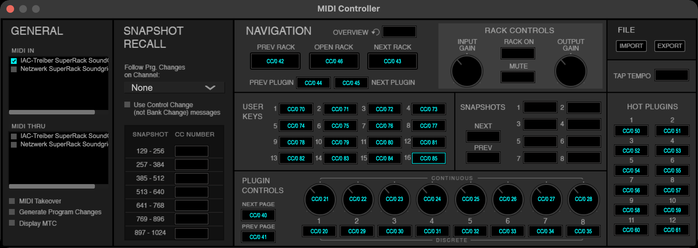
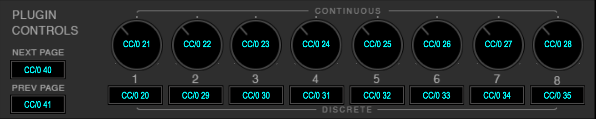
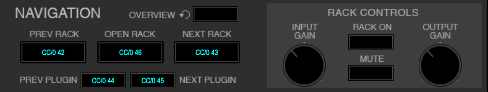
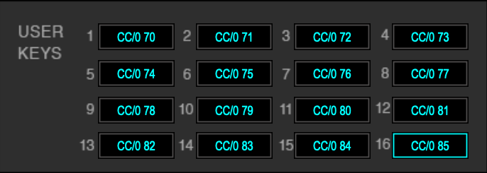
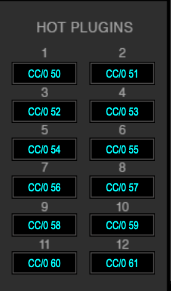

# Control Waves Tune Real-Time in SuperRack SoundGrid via MIDI

**English** | [Deutsch](README_DE.md)

This guide shows how to reliably set the key (scale root) and scale of **Waves Tune Real-Time** in
**SuperRack SoundGrid** via MIDI, including for all Tune RT instances at once.

Tested in October 2026 with SuperRack SoundGrid 15.15.12 and Tune Real-Time on macOS.
All results were read directly from the plugin (screenshots and text recognition). The SoundGrid server was offline
during testing, but the plugin parameters still respond.

## Summary

- Tune RT itself **cannot** set key and scale through its own MIDI input.
  Target Pitch and Reference Tone only accept single notes, one at a time.
- In SuperRack it works through the **Plugin Controls** of the MIDI Controller module:
  **Continuous 7 = Scale Root**, **Continuous 8 = Scale Type** (on page 2).
- The Scale Root control acts **relative** to its previous state. A fixed value therefore does not always
  give the same root.
- The reliable way: first set Scale Type to **Chromatic**, then to the desired scale. The root is then always
  **A**. From there, a fixed sequence of 1 to 3 root values reaches each of the 12 roots.
- Tested with **all 42 scales** of Tune RT, all 12 roots each. **No deviations** for 41 scales.
  The exception is **User Scale**.
- **Send to All** (page 3, Discrete 1) transfers scale and root to **all** other Tune RT instances with
  **Receive** enabled.
- A specific Tune RT can be selected absolutely via **Hot Plugin** or **User Key**, a rack via rack navigation.
- The Python script [`tunert_midi.py`](tunert_midi.py) does everything in one call:
  `key D --scale harmonic-minor --hot-plugin 2 --send-to-all`.

## Setup: MIDI Controller in SuperRack

All examples and the script use this mapping. It is included as a file:
[`SuperRack_TuneRT_MIDI.mrrc`](SuperRack_TuneRT_MIDI.mrrc), exported from SuperRack 15.15.12.

**Import:**
1. SETUP → INVENTORY → CONTROLLERS: assign a **MIDI Controller** module if there is none yet.
2. The gear icon below the module opens the "MIDI Controller" window.
3. Under **MIDI IN**, tick the port the commands come in on. For commands from the same Mac, an IAC bus works well;
   set it up in "Audio MIDI Setup" → MIDI Studio → IAC Driver.
4. FILE → **IMPORT** → select `SuperRack_TuneRT_MIDI.mrrc`.
5. Close the window (see the note on learn mode below).



`CC/0 42` means: Control Change 42 on MIDI channel 1 (SuperRack counts channels from 0).
All 51 commands use Control Change on channel 1.

| Area | Command | CC |
|---|---|---|
| Plugin Controls | Continuous 1–8 | 21–28 |
| Plugin Controls | Discrete 1 | 20 |
| Plugin Controls | Discrete 2–8 | 29–35 |
| Plugin Controls | NEXT PAGE / PREV PAGE | 40 / 41 |
| Navigation | PREV RACK / NEXT RACK | 42 / 43 |
| Navigation | PREV PLUGIN / NEXT PLUGIN | 44 / 45 |
| Navigation | OPEN RACK | 46 |
| Hot Plugins | 1–12 | 50–61 |
| User Keys | 1–16 | 70–85 |

Any MIDI controller or software that sends these CCs works. The script is just one option.

**Plugin Controls.** These address Scale Root (Continuous 7), Scale Type (Continuous 8) and Send to All
(Discrete 1 on page 3):



**Navigation.** Rack selection and page reset:



**User Keys and Hot Plugins.** These select a specific Tune RT directly:

 

Which plugin a Hot Plugin or User Key selects is defined in SuperRack itself. A User Key shows its target
e.g. as `R32P2`, i.e. rack 32, plugin 2.

**Learning your own mapping:** click a field in the window, then send the CC from your controller.
Afterwards **close** the window. As long as a field is selected, learn mode is active. Every CC that is already
assigned then triggers an "already assigned … Yes/No" prompt instead of controlling the plugin.

## Setting key and scale

Prerequisite: Tune RT is the selected plugin, and the Plugin Controls are on **page 2** (Scale).
After every rack or plugin change they are on **page 1**, so press **NEXT PAGE once**.

**Important:** navigation and momentary buttons (NEXT/PREV PAGE, NEXT/PREV RACK, NEXT/PREV PLUGIN, Hot Plugins,
User Keys, Send to All) trigger on **every** message, including value 0. So send exactly **one** message per
press, e.g. value 127.

1. Scale Type (CC 28) = **4** (Chromatic). This is the reset.
2. Scale Type (CC 28) = value of the desired scale (table below). The root is now **A**.
3. Scale Root (CC 27): send the values from the root table **one after another**.
4. Optional **Send to All**: NEXT PAGE (→ page 3), Discrete 1 (CC 20), PREV PAGE (back to page 2).
   All other Tune RT instances with Receive enabled now take over scale and root.

Example D Harmonic Minor, as Control Change on channel 1:

| Step | CC | Value |
|---|---|---|
| Chromatic | 28 | 4 |
| Harmonic Minor | 28 | 12 |
| Root step 1 | 27 | 36 |
| Root step 2 | 27 | 36 |
| Root step 3 → D | 27 | 54 |
| NEXT PAGE (optional, for Send to All) | 40 | 127 |
| Send to All | 20 | 127 |
| PREV PAGE | 41 | 127 |

### Scale Type (Continuous 8)

The value is absolute, independent of the previous value. Verified with jumps such as 0 → 50, 127 → 50 and 30 → 50.
Each scale occupies a range of usually 3 values. The middle value ("recommended") is the safest choice.
The names were read from the plugin. "…" marks where the plugin itself abbreviates the name.

| Range | Recommended | Scale | `--scale` | Recipes tested |
|---|---|---|---|---|
| 0–1 | 0 | User Scale | – | ✗ does not work |
| 2–4 | **4** | Chromatic | – | (reset value) |
| 5–7 | 6 | Major | `major` | ✓ 2× |
| 8–10 | 9 | Natural Minor | `natural-minor` | ✓ 2× |
| 11–13 | 12 | Harmonic Minor | `harmonic-minor` | ✓ 2× |
| 14–16 | 15 | Melodic Minor (Ascending) | `melodic-minor` | ✓ 2× |
| 17–19 | 18 | Melodic Minor (Ascending & Descending) | `melodic-minor-ad` | ✓ 2× |
| 20–22 | 21 | Major Justonic | `major-justonic` | ✓ |
| 23–25 | 24 | Minor Justonic | `minor-justonic` | ✓ |
| 26–28 | 27 | Dorian | `dorian` | ✓ |
| 29–31 | 30 | Mixolydian | `mixolydian` | ✓ |
| 32–33 | 32 | Blues | `blues` | ✓ |
| 34–36 | 35 | Phrygian | `phrygian` | ✓ |
| 37–39 | 38 | Locrian | `locrian` | ✓ |
| 40–42 | 41 | Lydian | `lydian` | ✓ |
| 43–45 | 44 | Whole Tone | `whole-tone` | ✓ |
| 46–48 | 47 | Diminished (W-H) | `diminished-wh` | ✓ |
| 49–51 | 50 | Diminished (H-W) | `diminished-hw` | ✓ |
| 52–54 | 53 | Bebop | `bebop` | ✓ |
| 55–57 | 56 | Major Pentatonic | `major-pentatonic` | ✓ |
| 58–60 | 59 | Minor Pentatonic | `minor-pentatonic` | ✓ |
| 61–63 | 62 | Major Pent… flat 3rd | `major-pentatonic-flat3` | ✓ |
| 64–66 | 65 | Minor Pen… + Blues | `minor-pentatonic-blues` | ✓ |
| 67–69 | 68 | Bebop + Blues | `bebop-blues` | ✓ |
| 70–72 | 71 | Pythagorean | `pythagorean` | ✓ |
| 73–75 | 74 | Maqam Ra…st-Rast) | `maqam-rast` | ✓ |
| 76–78 | 77 | Maqam Saba | `maqam-saba` | ✓ |
| 79–81 | 80 | Maqam Bayati | `maqam-bayati` | ✓ |
| 82–84 | 83 | Maqam Nahawand | `maqam-nahawand` | ✓ |
| 85–87 | 86 | Maqam Hijaz | `maqam-hijaz` | ✓ |
| 88–90 | 89 | Maqam Kurd | `maqam-kurd` | ✓ |
| 91–93 | 92 | Maqam Huzam | `maqam-huzam` | ✓ |
| 94–95 | 94 | Bilawal (Hindustani) | `bilawal-hindustani` | ✓ |
| 96–98 | 97 | Bilawal (Carnatic) | `bilawal-carnatic` | ✓ |
| 99–101 | 100 | Kafi (Hindustani) | `kafi-hindustani` | ✓ |
| 102–104 | 103 | Kafi (Carnatic) | `kafi-carnatic` | ✓ |
| 105–107 | 106 | Bhairavi (Hindustani) | `bhairavi-hindustani` | ✓ |
| 108–110 | 109 | Bhairavi (Carnatic) | `bhairavi-carnatic` | ✓ |
| 111–113 | 112 | Kalyan (Hindustani) | `kalyan-hindustani` | ✓ |
| 114–116 | 115 | Kalyan (Carnatic) | `kalyan-carnatic` | ✓ |
| 117–119 | 118 | Khamaj (Hindustani) | `khamaj-hindustani` | ✓ |
| 120–122 | 121 | Khamaj (Carnatic) | `khamaj-carnatic` | ✓ |
| 123–125 | 124 | Asavari (Hindustani) | `asavari-hindustani` | ✓ |
| 126–127 | 126 | Asavari (Carnatic) | `asavari-carnatic` | ✓ |

For Blues (32–33) and Bilawal (Hindustani) (94–95) the range is only 2 values wide.
"✓ 2×": all 12 roots in two runs, "✓": in one run.

### Scale Root (Continuous 7): sequences starting from A

Applies to all scales except User Scale.

| Root | Values in order | Input for `key` |
|---|---|---|
| C | 36, 36 | `C`, `His`, `B#` |
| C♯ / D♭ | 36 | `C#`, `Cis`, `Db`, `Des` |
| D | 36, 36, 54 | `D` |
| D♯ / E♭ | 18, 54 | `D#`, `Dis`, `Eb`, `Es` |
| E | 54 | `E`, `Fes`, `Fb` |
| F | 72, 5 | `F`, `Eis`, `E#` |
| F♯ / G♭ | 18, 72 | `F#`, `Fis`, `Gb`, `Ges` |
| G | 72 | `G` |
| G♯ / A♭ | 90 | `G#`, `Gis`, `Ab`, `As` |
| A | 5 | `A` |
| A♯ / B♭ | 18, 108 | `A#`, `Ais`, `Bb` |
| B | 18 | `B`, `H`, `Ces`, `Cb` |

Inputs are case-insensitive. German note names (`Cis`, `Es`, `H` …) are accepted too; `B` is always B natural.
In some shells (e.g. zsh with `extendedglob`) `#` must be quoted: `"F#"`. Flat spellings like `Gb` avoid that.

Tune RT displays some roots as their enharmonic equivalent (e.g. G♭ instead of F♯). The pitch is the same.

### Send to All

- Located on **page 3, Discrete 1**, right next to Receive (page 3, Discrete 2).
- Without Send to All, nothing changes on the other instances.
- It affects **all** instances with Receive. Instances that should not follow need Receive turned off.
- Tested: one instance was set to D Dorian and F♯ Harmonic Minor, then Send to All was pressed.
  Two further instances with Receive in other racks took over scale and root each time.

### Pauses between messages

Major, all 12 roots × 2 runs per pause length:

| Pause | Correct |
|---|---|
| 0.5 s | 24/24 |
| 0.3 s | 24/24 |
| 0.2 s | 24/24 |
| 0.1 s | 24/24 |
| 0.05 s | 24/24 |
| 0 s | 24/24 |

The script uses 0.1 s by default. The recipe tests for all scales ran with 0.6 s / 0.9 s.

## Selecting the target plugin

With several Tune RT instances, the right one has to be selected first. There are three ways:

| Way | Selects | MIDI sequence (one message each) |
|---|---|---|
| Hot Plugin N (1–12) | the plugin on Hot Plugin N | PREV RACK, NEXT RACK, Hot Plugin N, NEXT PAGE |
| User Key N (1–16) | whatever User Key N triggers | PREV RACK, NEXT RACK, User Key N, NEXT PAGE |
| Rack N | rack N, with the plugin last selected there | PREV RACK × 64, NEXT RACK × N, PREV RACK, NEXT PAGE |

Hot Plugin and User Key select a **specific plugin** absolutely; rack navigation only selects the rack.

**Why PREV RACK + NEXT RACK first?** The Plugin Controls only jump to page 1 on an actual rack or
plugin change. If the target plugin is already selected, the page stays where it is, and NEXT PAGE ends up
on the wrong page. Going back and forth forces a change, even at the edges: at rack 1, PREV does not move but
NEXT does; at the last rack it is the other way round. For the same reason, rack selection ends with NEXT × N and PREV × 1.

Measured:
- Hot Plugins and User Keys select their plugin on a second press as well. They do not toggle back and open no extra window.
- PREV RACK stops at rack 1. NEXT RACK counts every rack individually, including empty ones. 20 ms per step is enough.
- PREV/NEXT PLUGIN cycle through the occupied slots of a rack, and SuperRack remembers the last selected plugin
  per rack. They are therefore unsuitable for selecting a specific slot.
  "Next + previous plugin" only resets the page if the rack holds at least 2 plugins.

Tested with three Tune RT instances in rack 32 (slot 2), rack 17 and rack 18. Hot Plugin 1 / User Key 1 pointed to
rack 32, Hot Plugin 2 / User Key 2 to rack 17:

| Call | Result |
|---|---|
| `key Fis --scale dorian --hot-plugin 1` | rack 32 = F♯ Dorian |
| `key A --hot-plugin 2 --send-to-all` | rack 17 = A Major, rack 32 takes over A Major |
| `key E --scale natural-minor --user-key 2` | rack 17 = E Natural Minor, rack 32 stays A Major |
| `key C --user-key 1` | rack 32 = C Major |
| `key G --rack 18` | rack 18 = G Major, rack 17 stays E Natural Minor |

In addition, 6 starting situations for the page reset, all correct: plugin already selected, page shifted by 1 or 2,
switching between two instances, starting at rack 1.

## The script `tunert_midi.py`

Requires Python 3 and the packages from [`requirements.txt`](requirements.txt) (`mido`, `python-rtmidi`):

```bash
python3 -m venv .venv
.venv/bin/pip install -r requirements.txt
.venv/bin/python tunert_midi.py ports
```

`ports` lists the MIDI outputs. Without `--port`, the script uses the first output with "IAC" or "SuperRack"
in its name. Use `--port <part of the name>` to choose another one.

Setting a key:

```bash
.venv/bin/python tunert_midi.py key D --scale harmonic-minor
.venv/bin/python tunert_midi.py key Eb --scale dorian --hot-plugin 2 --send-to-all
.venv/bin/python tunert_midi.py key Gb --scale-value 41 --rack 18
```

| Option | Meaning |
|---|---|
| `ROOT` | root note, see the root table for accepted spellings (case-insensitive) |
| `--scale NAME` | scale from the `--scale` column, default `major` |
| `--scale-value N` | scale by its Scale Type value |
| `--hot-plugin N` / `--user-key N` / `--rack N` | select the target plugin first (mutually exclusive) |
| `--send-to-all` | press Send to All afterwards |
| `--pause SEC` | pause after each message, default 0.1 |
| `--root-cc`, `--type-cc`, `--send-cc`, `--next-page-cc`, `--prev-page-cc`, `--prev-rack-cc`, `--next-rack-cc`, `--hot-plugin-cc`, `--user-key-cc` | different CCs if your mapping differs |

Without `--hot-plugin`, `--user-key` or `--rack`, the script assumes Tune RT is already selected and page 2 is active.

Further commands: `send` (single CC), `learn` (send a CC repeatedly for MIDI learn), `sweep` (step through CC
values and save the result as CSV), `snapshot` (recall a SuperRack snapshot via Program Change).

## Measurements

### One step from A (Major, sweep 0–127, Chromatic → Major before each value)

| CC value | Root |
|---|---|
| 0–9 | A |
| 10–27 | B |
| 28–45 | D♭ |
| 46–63 | E |
| 64–81 | G |
| 82–99 | A♭ |
| 100–127 | B |

So the control has 8 steps of 18 values each (0–9, 10–27, …, 118–127).

### Two steps from A (row = 1st value, column = 2nd value)

| 1st \ 2nd | 5 | 18 | 36 | 54 | 72 | 90 | 108 | 122 |
|---|---|---|---|---|---|---|---|---|
| **5** | A | B | D♭ | E | G | A♭ | B | B |
| **18** | A♭ | B | C♯ | E♭ | G♭ | G♯ | B♭ | B |
| **36** | G♭ | A | C | D♭ | E | G♭ | A♭ | B |
| **54** | G♭ | A | C | D♭ | E | F♯ | A♭ | B |
| **72** | F | G♯ | C | C | D♯ | E | G | A♯ |
| **90** | A♭ | B | D♭ | E♭ | G♭ | A♭ | B♭ | B |
| **108** | A♭ | B | C♯ | E♭ | G♭ | G♯ | B♭ | B |
| **122** | A♭ | B | C♯ | E♭ | G♭ | G♯ | B♭ | B |

With two steps, 11 roots are reachable. D needs three (36, 36, 54).

### Without the reset: not usable

Without Chromatic → scale first, the result depends on the previous root.
Example: CC 50 approached from 0 gave E♭, approached from 127 gave D♯. The sequence 0, 1, 2, 3, 4, 5 gave
G♯, F♯, G♭, E, G♭, E.

## Plugin Controls map for Tune RT

Tune RT has three pages. NEXT/PREV PAGE wrap around after the last one.
After every rack or plugin change, page 1 is active.

| Page | Field | Tune RT parameter |
|---|---|---|
| 1 (Controls) | Continuous 1 | Correction (amount) |
| 1 (Controls) | Continuous 3 | Vibrato amount |
| 1 (Controls) | Continuous 5 | Note Transition |
| 1 (Controls) | Continuous 6 | Tolerance Time |
| 1 (Controls) | Continuous 7 | Tolerance Cents |
| 1 (Controls) | Continuous 8 | Speed |
| 1 (Controls) | Discrete 1 | Correction ON (toggles) |
| 1 (Controls) | Discrete 2 | Formant |
| 1 (Controls) | Discrete 3 | Vibrato ON |
| 1 (Controls) | Discrete 8 | Link |
| **2 (Scale)** | Continuous 1 | Level (MIDI Input) |
| **2 (Scale)** | Continuous 3 | Reference (Hz) |
| **2 (Scale)** | Continuous 4 | Range (Bass … Generic) |
| **2 (Scale)** | **Continuous 7** | **Scale Root** |
| **2 (Scale)** | **Continuous 8** | **Scale Type** |
| **2 (Scale)** | Discrete 1 | Reference Tone |
| **2 (Scale)** | Discrete 2 | Target Pitch |
| **2 (Scale)** | Discrete 5 | Group Octaves |
| **2 (Scale)** | Discrete 6 | probably Reset Scale (not tested separately) |
| **2 (Scale)** | Discrete 7 | ♭/♯ display |
| 3 (Transmission) | **Discrete 1** | **Send to All** |
| 3 (Transmission) | Discrete 2 | Receive |
| 3 (Transmission) | Continuous 7/8 | keyboard display range |

Reset Scale and Send to All are momentary buttons and show no visible effect in their own plugin.
Send to All was identified through its effect on the other instances. The procedure above does not need Reset Scale.
